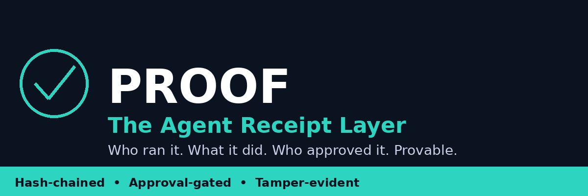
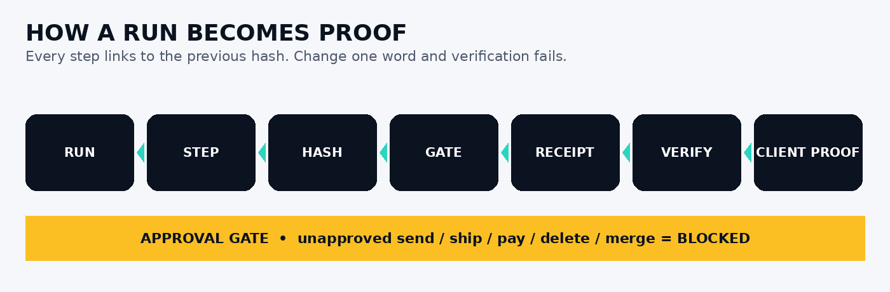
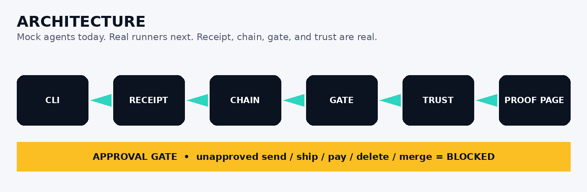
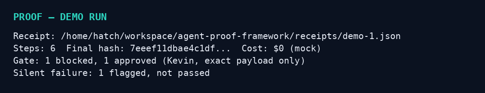
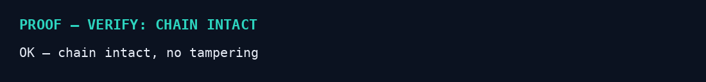
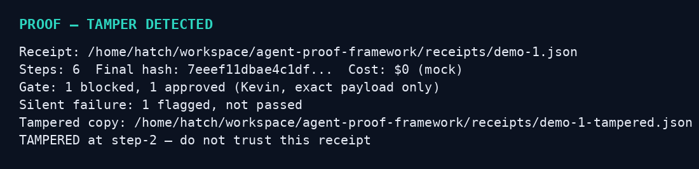

[](https://www.python.org/) [](https://opensource.org/licenses/MIT) [] [] [] [] []

# PROOF — The Agent Receipt Layer

**One sentence:** Every agent run gets a provable receipt. Who ran it, what it did, what it was allowed to do, who approved it, what it cost, and whether the record was tampered with.

## The gap it fills

Agent frameworks today can *produce* work. They cannot *prove* it.
A study of the four most widely used frameworks (Partnership on AI, Oct 2026) found the records that matter are simply missing:

- No persistent agent IDs — you can't tell which agent did what over time
- No human-approval records — you can't reconstruct who authorized a task, or when
- No permission / memory change logs — silent shifts in what an agent may do go unnoticed
- No decision records you can verify — logs are self-reported, so an agent can delete a thing and then deny it

Add the other documented failures: multi-agent memory fragments, sub-tasks fail silently, and nobody watches the sequence of actions *between* authorization and audit — three individually-authorized tool calls can collectively exfiltrate data.

PROOF is the layer that sits *under* any agent — Orchestra, Battle Court, Hermes Caller, Codex, OpenCode, Pi, whatever — and makes its work provable, replayable, and client-shareable.

## What makes it one-of-a-kind

1. **Persistent agent identity** — an agent_id that survives restarts. Trust compounds across runs, it doesn't reset every session.
2. **Hash-chained receipts** — every step links to the previous step's hash. Change one word in step 3 and verification of the whole receipt fails. Tamper-evident, not tamper-proof marketing.
3. **Approval is a receipt, not a log line** — send / ship / pay / delete / merge are blocked until a human approves *that exact payload*. The approval itself is chained into the receipt.
4. **Silent-failure detector** — a step with no output, no evidence, or a timeout is flagged FAILED, never silently passed.
5. **Cost + provenance on every step** — model, tokens (mock $0 in the skeleton), source, and why that step happened.
6. **Client proof page** — one static HTML page per run. Send it to a client and they can see what was done, what was approved, and verify the chain themselves. No animation, no dashboard login.

## Honest status — skeleton v0.1.0

- Agents are mocks ($0, no real model calls). Real runners are the next step.
- Hash chain is SHA-256 chaining, verified locally. This is tamper-*evident*, not a cryptographic signature scheme — that claim is not made.
- No pricing, no payment, no release. Never auto-sends, auto-ships, auto-pays, or auto-deletes.

## Quick start

```bash
python3 run.py demo
python3 run.py verify receipts/demo-1.json
python3 run.py proof receipts/demo-1.json
python3 run.py trust
```

`demo` runs 3 mock agents, one of which silently fails and gets flagged, one dangerous action gets gate-blocked, then approved exactly once.
`verify` recomputes the chain and reports OK or TAMPERED.
`proof` writes a static `proof.html` next to the receipt.

## How it plugs into your stack

- **Robot Orchestra:** the Boss head's runs get receipts. A client can verify what the head actually did.
- **Battle Court:** the winner's receipt is the evidence bundle. The loser keeps its receipt too — no history rewriting.
- **Hermes Caller:** every dial-prep, qualify, and packet gets a receipt. A scrubbed number never gets a receipt for a call, because the call never happens.
- **AgencyLead.ca:** a lead pack ships with its receipts. "Here are your 25 leads, and here is proof of how each one was found, scored, and checked."

## Commands

- `run.py demo` — full demo run
- `run.py verify <receipt>` — verify a receipt chain
- `run.py proof <receipt>` — render static proof.html
- `run.py trust` — show compounding trust per agent
- `run.py tamper-demo` — tamper a copy and show verify failing

## Workflow



## Architecture



## Screenshots — real CLI output






